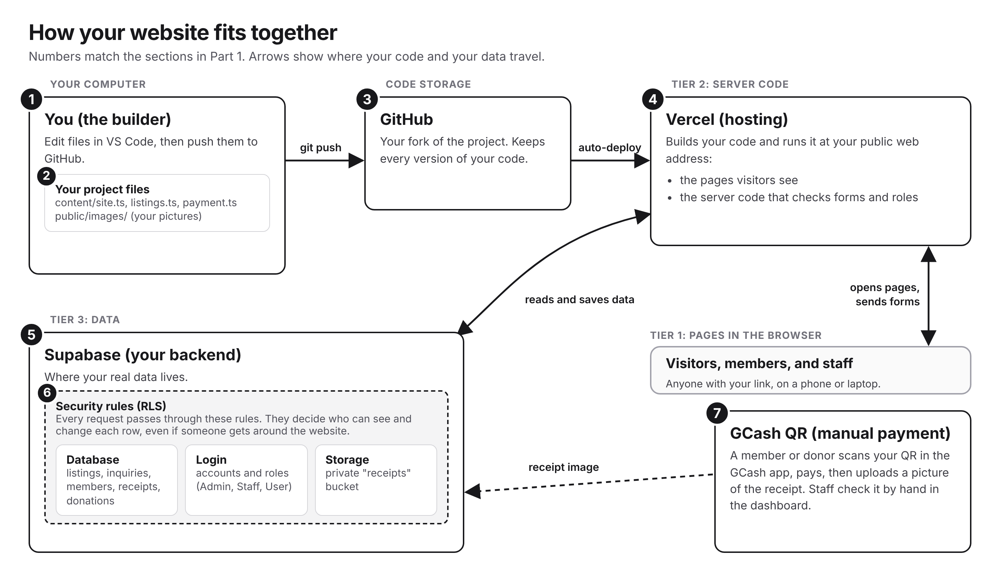

# Part 1: Introduction and Architecture

This part has no steps to follow along. It explains what you are building and how the pieces connect, so the hands-on parts make sense. Give it a read, then move on to Part 2.

---

## What you are building

Over three sessions you build and launch a **three-tier catalog and membership website**. Visitors can browse a catalog of services and send inquiries. People can sign up, submit a payment receipt to become a member, and make donations. Staff and admins get private dashboards to review inquiries, approve receipts, verify donations, and manage listings.

You will not write this from scratch. The project is already built. You get your own copy, put it online, change a few files to make it yours, connect your own database, and then operate the finished dashboards.

The whole thing uses four building blocks:

- **Next.js**: the website framework. It builds both the pages people see and the behind-the-scenes code that handles their requests.
- **Supabase**: your backend. It is your database (the thing that remembers data), your login system, and your file storage, all in one.
- **Vercel**: the hosting service that puts your site on the internet with a public web address.
- **GitHub**: where your code lives online and which triggers a new deploy every time you push a change.

---

## Architecture overview

Here is how the pieces fit together. Each numbered item below matches a box in the diagram.

### 1. You (the builder)

You edit a few files on your computer in VS Code, then push them to GitHub. You also sign in to Supabase and Vercel to set up your backend and hosting.

### 2. Your project files

The project is a Next.js app. You only ever change three content files to make the site yours:

- `content/site.ts`: the site name, headline, and intro text on the landing page.
- `content/listings.ts`: your catalog items (title, description, category, and which inquiry form shows).
- `content/payment.ts`: the GCash payment label and account name.

Everything else is already written for you.

### 3. GitHub repository

Your code lives in your own copy (a "fork") on GitHub. GitHub keeps a history of every change. When you push a change, it tells Vercel to re-publish your site.

### 4. Vercel (hosting)

Vercel takes your code from GitHub, builds it, and serves it to the public at your own web address. Because Vercel watches your GitHub repo, every push you make goes live automatically. You do not upload files by hand.

### 5. Supabase (your backend)

Supabase is where your real data lives. It has three jobs:

- **Database**: stores listings, inquiries, members, receipts, and donations.
- **Authentication (login)**: lets people register and sign in.
- **Storage**: holds uploaded payment receipt images in a private bucket.

### 6. Row Level Security (we will call it RLS)

RLS is the set of rules inside the database that decides who can see and change what. For example, a regular user cannot read someone else's receipt, and only staff can approve a membership. These rules live in the database itself, so even if someone got around the buttons on the website, the database still blocks them. This is the signature lesson of the workshop.

### 7. GCash QR (manual payments)

The site shows a GCash QR so a member or donor can pay, then upload a receipt image. No real money moves during the workshop. A staff member reviews the receipt by hand and approves or rejects it. This mirrors how plenty of small businesses actually verify payments.

---

## Why this setup matters

This is close to how modern web teams actually build and ship products.

- **One codebase, front and back**: Next.js handles both the pages and the server logic, which is a common real-world pattern.
- **Deploy on every push**: connecting GitHub to Vercel means your changes go live automatically. This is the idea behind continuous deployment.
- **Security in the database, not just the buttons**: RLS protects your data at the lowest level, which is how real systems keep users from seeing each other's private records.
- **You own all of it**: your own GitHub repo, your own Supabase project, your own Vercel site. Nothing is shared with the instructor's account.

---

## What success looks like, one win per day

- **Day 1:** your site is live on the internet at your own address, with your own branding and catalog.
- **Day 2:** your forms save real data to your own database.
- **Day 3:** you approve a payment, a user becomes a member, and you watch the security rules block someone who should not have access.

When you can do all three, you have built and operated a real three-tier web application.

Ready? Continue to **[Part 2: Build the Storefront](./Part-2-Build-the-Storefront.md)**.
